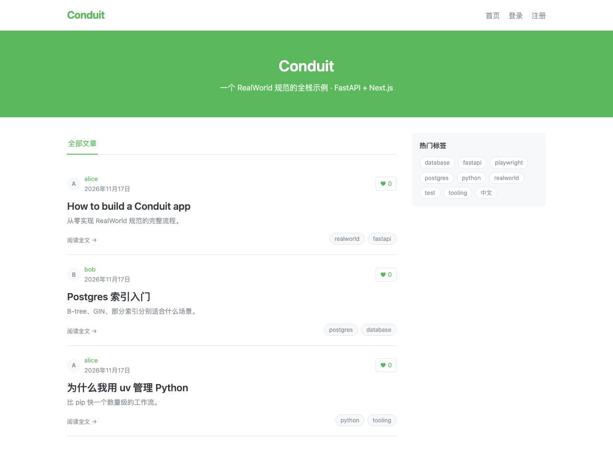
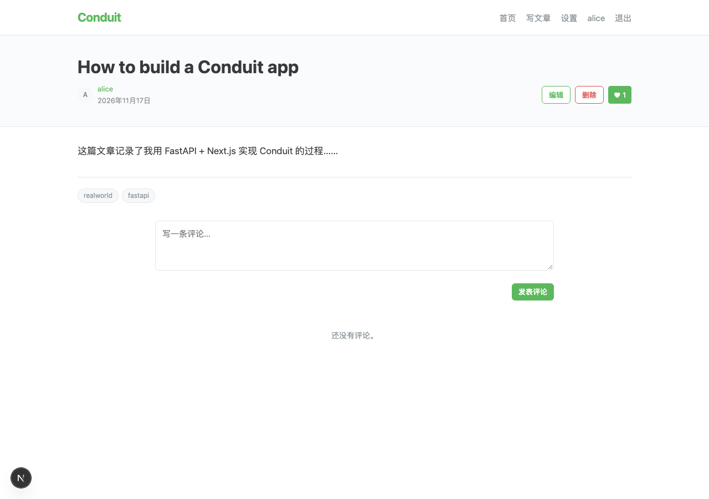
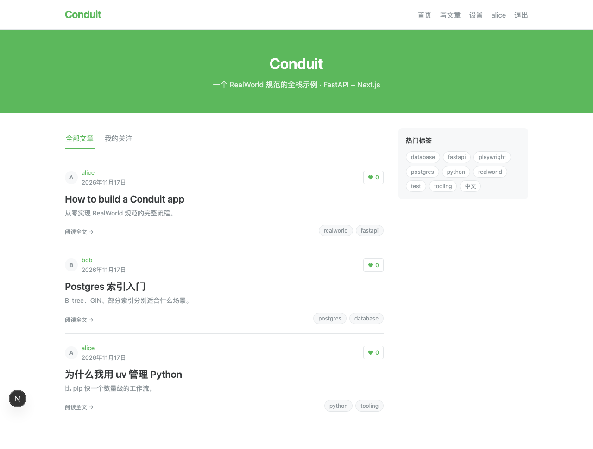

# Conduit

一个能跑的博客社区。后端 FastAPI，前端 Next.js，接口照 [RealWorld](https://realworld-docs.netlify.app/) 规范写。

写得不算大：后端 700 行，前端 900 行。想改哪块直接翻，不用在抽象层里绕。



## 为什么有这个仓库

想练全栈，又不想每次从零搭架子，就把一个完整的增删改查做透。

注册、发文章、点赞、关注、评论、筛选、分页，该有的都有。clone 下来能直接跑，改坏了能自己修。

## 能用的功能

- 注册、登录，JWT 鉴权
- 发文章、改自己的、删自己的
- 点赞，关注作者，只看关注的人的动态
- 评论，删自己的评论
- 按标签筛，翻页
- 改个人资料和密码

| 文章详情 | 登录后的首页 |
|---|---|
|  |  |

## 跑起来

要三样东西：Docker、Node 20 以上、Python 3.11 以上。

```bash
git clone https://github.com/Ma-yucheng/conduit-demo.git
cd conduit-demo

# 1. 数据库
docker compose up -d

# 2. 后端，8000 端口
cd conduit/backend
python -m venv .venv && source .venv/bin/activate
pip install -r requirements.txt
cp .env.example .env
python seed.py                 # 灌几篇演示文章，可重复执行
uvicorn app.main:app --reload --port 8000

# 3. 前端，3000 端口（新开一个终端）
cd conduit/frontend
pnpm install                   # 用 npm / yarn 也行
pnpm dev
```

打开 http://localhost:3000。

演示账号 `alice@example.com`，密码 `password123`。bob 同密码。

接口文档在 http://127.0.0.1:8000/docs，能直接在网页上点着调。

macOS 上想省事，根目录有 `./run.sh start`，前后端一起起。

## 技术栈

| 层 | 用的什么 |
|---|---|
| 后端 | FastAPI、SQLAlchemy 2.0（异步）、asyncpg |
| 数据库 | PostgreSQL 16 |
| 鉴权 | PyJWT + PBKDF2（标准库实现，没引 bcrypt） |
| 前端 | Next.js 16 App Router、React 19、TypeScript |
| 样式 | 手写 CSS，没用 UI 库 |

## 目录

```
conduit-demo/
├── docker-compose.yml      只起数据库
├── run.sh                  前后端一键启停（可选）
└── conduit/
    ├── backend/app/
    │   ├── routers/        按资源拆：users / articles / comments / profiles / tags
    │   ├── models.py       5 张表
    │   ├── security.py     密码散列和 JWT
    │   └── payloads.py     拼返回结构，顺手算点赞数
    └── frontend/
        ├── app/            页面
        └── lib/            api 封装、登录态 hook
```

## 接口

跑起来后看 `/docs` 更清楚，下面是速查。

| 方法 | 路径 | 做什么 |
|---|---|---|
| POST | `/api/users` | 注册 |
| POST | `/api/users/login` | 登录 |
| GET / PUT | `/api/user` | 当前用户、改资料 |
| GET | `/api/profiles/:username` | 看别人的资料 |
| POST / DELETE | `/api/profiles/:username/follow` | 关注、取关 |
| GET | `/api/articles` | 列表。支持 `tag` `author` `favorited` `limit` `offset` |
| GET | `/api/articles/feed` | 关注的人的动态 |
| POST | `/api/articles` | 发文章 |
| GET / PUT / DELETE | `/api/articles/:slug` | 详情、改、删 |
| POST / DELETE | `/api/articles/:slug/favorite` | 点赞、取消 |
| GET / POST | `/api/articles/:slug/comments` | 评论列表、发评论 |
| DELETE | `/api/articles/:slug/comments/:id` | 删评论 |
| GET | `/api/tags` | 所有标签 |

## 做了哪些简化

不是漏了，是故意的，知道就行：

- **密码**用标准库的 PBKDF2，演示够用。真上线换 argon2 或 bcrypt。
- **建表**靠 `create_all`，改了模型要重建库。生产该上 Alembic。
- **中文标题的 slug** 是随机串。拼音转写没做，不影响用。
- **点赞数**是每次查出来的，没存冗余字段。文章上万篇会慢。
- **没写测试**。这是最该补的一块，也是留给你的练习题。

## 能拿来练什么

按难度排：

1. 换个样式，改改 CSS。热更新开着的，存盘即见。
2. 加个「按最新 / 最热排序」的开关，前后端各改一点。
3. 接 Redis 存文章阅读数。环境里 Redis 也用得上。
4. 用 `pytest + httpx` 把注册 → 发文章 → 评论这条主链路测了。
5. 把 `create_all` 换成 Alembic，改模型不用重建库。
6. 部署。前端扔 Vercel，后端扔 Railway，数据库接 Neon。

## 许可

MIT
